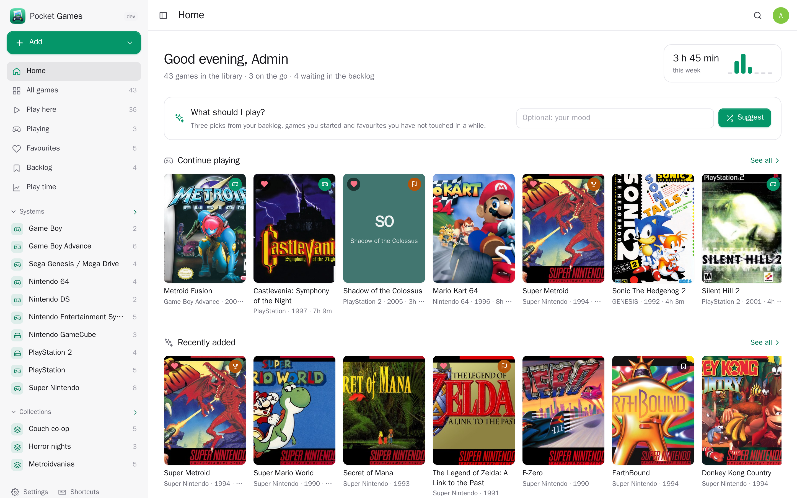
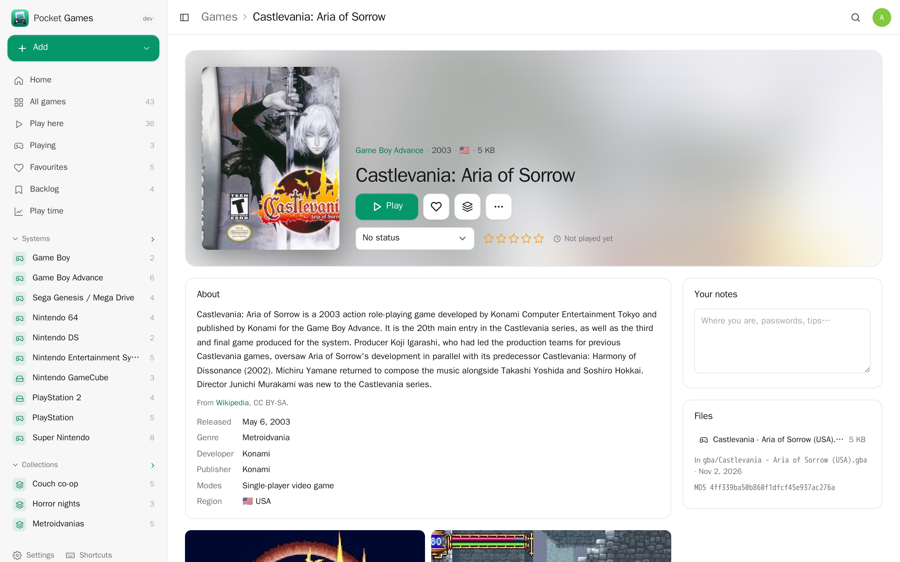
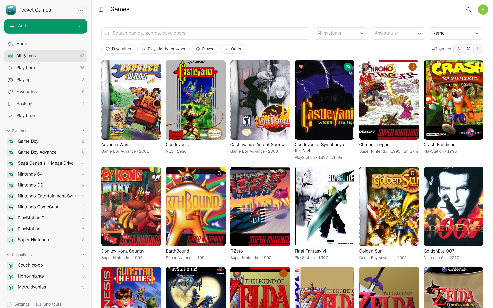
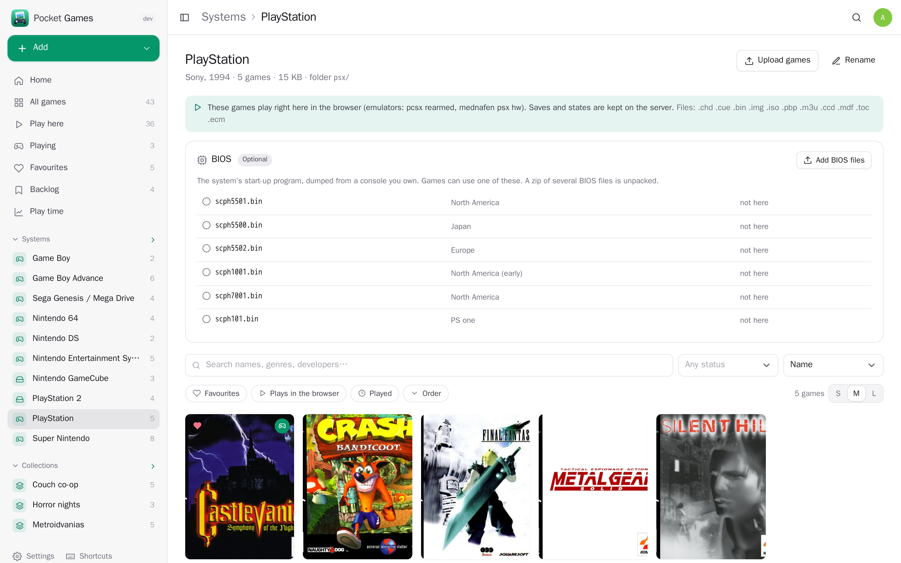
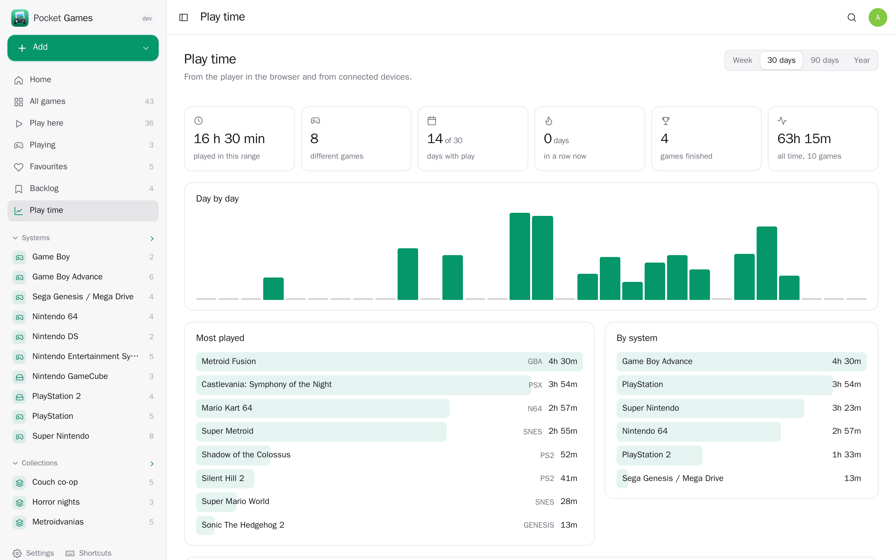
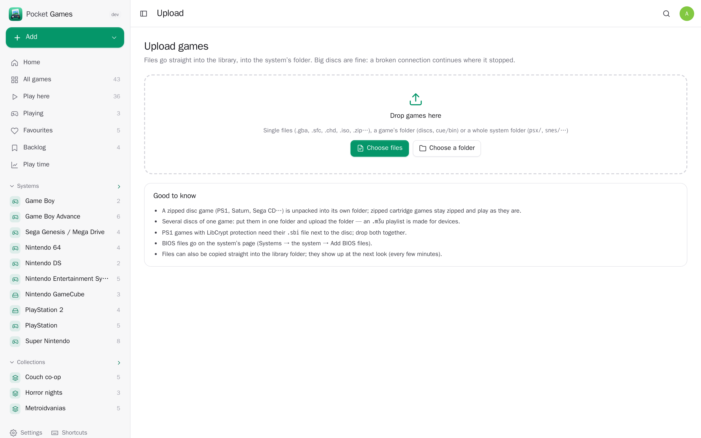
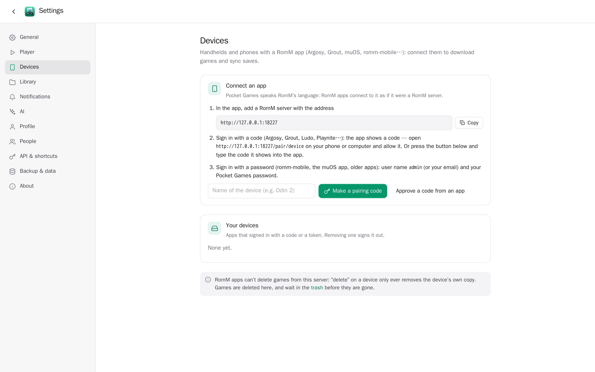
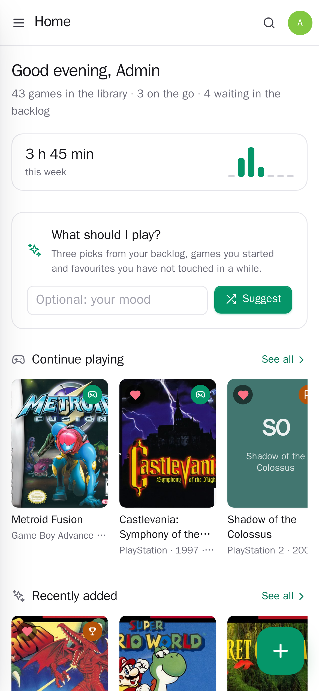
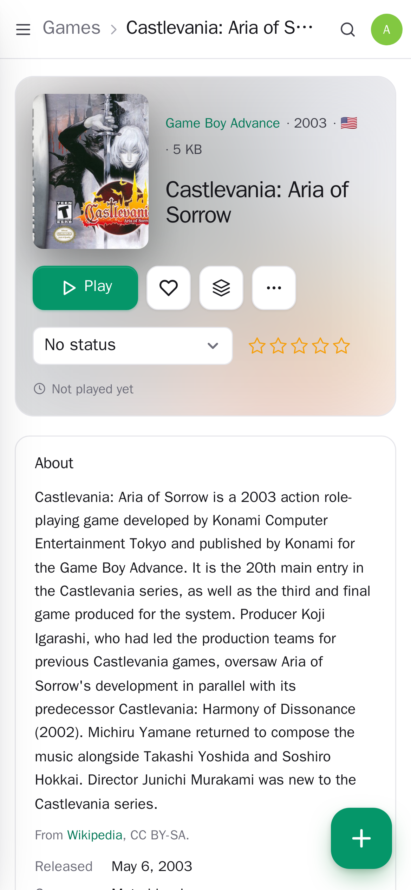
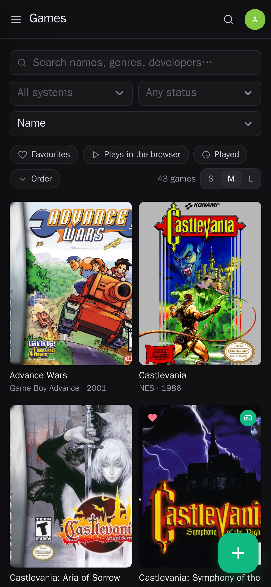

<p align="center"></p>

<h1 align="center">Pocket Games</h1>

<p align="center">Your retro game library: upload games, play them in the browser with saves that follow you, keep favourites, collections and play time — and let RomM apps on handhelds download games and sync saves. One Go binary, one SQLite file, one volume. Part of the Pocket apps; works on its own too.</p>

<p align="center">
  <a href="https://github.com/abjelosevic88/pocket-homelab-games/actions/workflows/ci.yml"></a>
  <a href="https://github.com/abjelosevic88/pocket-homelab-games/pkgs/container/pocket-homelab-games"></a>
  <a href="LICENSE"></a>
</p>

<p align="center"></p>

<table>
  <tr>
    <td></td>
    <td></td>
  </tr>
  <tr>
    <td></td>
    <td></td>
  </tr>
  <tr>
    <td></td>
    <td></td>
  </tr>
</table>

<p align="center">
  
  
  
</p>

## What it does

- **Play in the browser** — NES, SNES, N64, Game Boy (Color/Advance), DS, PlayStation, PSP, Genesis/Mega Drive, Master System, Game Gear, Sega CD, 32X, Saturn, PC Engine, Neo Geo, arcade, Atari, Lynx, WonderSwan, 3DO, C64, Amiga, DOS and more, through [EmulatorJS](https://emulatorjs.org). Gamepads, keyboard and on-screen buttons on phones. The player's files are fetched once and then kept on the server.
- **Saves that follow you** — in-game saves (memory cards, battery saves) go to the server while you play; leaving keeps a state of the moment (“When you left”); Play continues from there. Named states with pictures; from the browser, a phone or a handheld.
- **Upload anything** — drag single games, a game's folder (discs, cue/bin) or a whole system folder. Resumable in chunks, so a 40 GB disc set survives a flaky connection. Zipped discs are unpacked; cue/bin and chd + sbi sets are kept together; the system is recognised from the file.
- **Covers and descriptions without API keys** — box art, title screens and in-game pictures from the libretro thumbnail sets; descriptions from Wikipedia; genre, developer, publisher, release date and modes from Wikidata. Pick another cover or upload your own; what you type is never overwritten.
- **A RomM-compatible API** — Argosy, Grout, the muOS app, romm-mobile, Ludo, Playnite and other RomM apps connect as if this were RomM 5.4.1: browse, download (resumable, multi-disc zips with an `.m3u`), sync saves and states, report play time. Sign in with a password, a pairing code, or the device flow (`/pair/device`). RomM apps can't delete games here.
- **Yours, per person** — favourites, statuses (backlog, playing, finished, completed, dropped), half-star ratings, notes, collections, play time and saves belong to each person; the games are shared by the household.
- **Play time** — every sitting in the browser or on a device; a week at a glance, day-by-day bars, streaks, most played games and systems; time played elsewhere can be added.
- **“What should I play?”** — three picks from your own library for your mood or the time you have (Pocket AI or your OpenAI key), or from your backlog and unfinished games.
- **BIOS checks** — which files each system needs, checked against known good dumps; the right one for the game's region is handed to the player.
- **Library care** — the folder is read every few minutes (and after every upload); deleted games wait in a trash folder for 30 days; files that vanish keep their play time and saves; identical files are found; RomM's folder layout works as is.
- **Bring it over from RomM** — favourites, statuses, ratings, collections, saves, states and RomM's covers, matched by system and file name.

## Run it

```bash
docker run -d --name pocket-games -p 8080:8080 \
  -v ./data:/data -v ./library:/library \
  -e BASE_URL=https://games.example.com -e SECURE_COOKIES=true \
  -e ADMIN_EMAIL=you@example.com -e ADMIN_PASSWORD=change-me-please \
  ghcr.io/abjelosevic88/pocket-homelab-games:latest
```

Or `docker compose up -d` with [docker-compose.yml](docker-compose.yml), or a release binary (`pocket-games`, Linux/macOS/Windows/FreeBSD). Put games into `library/roms/<system>/` (e.g. `snes/`, `gba/`, `psx/`) and BIOS files into `library/bios/<system>/`, or upload them in the app. Without an account yet, the first visit asks you to make one.

Everything is configured with environment variables — see [docs/configuration.md](docs/configuration.md). Backups: [docs/backup.md](docs/backup.md). Behind a proxy: [docs/reverse-proxy.md](docs/reverse-proxy.md). The API and the RomM-compatible API: [docs/api.md](docs/api.md).

## With Pocket Core

Set `CORE_URL` and `CORE_REGISTRATION_KEY` and Pocket Games joins the box: people sign in with Pocket Core, Pocket AI picks games, and other apps hear about it — `games.played` (a sitting ended, with minutes), `games.added`, `games.status_changed` — so Pocket Day can write what you played into your journal and Pocket Flows can react. Other Pocket apps can be allowed to read your games and play time (`games:read`) or track them for you (`games:write`).

## Develop

```bash
make run     # web + Go, demo data, no login, http://localhost:8080
make test    # go vet, go test, tsc
```

Go 1.26, SQLite (pure Go), React 19 + Vite. The screenshots come from `scripts/screenshots.mjs` against a demo instance.

## Credits

The in-browser player is [EmulatorJS](https://github.com/EmulatorJS/EmulatorJS) (GPL-3.0, loaded at run time, not bundled). Box art: [libretro-thumbnails](https://github.com/libretro-thumbnails/libretro-thumbnails). Descriptions: Wikipedia (CC BY-SA) and Wikidata (CC0). Bring your own games and BIOS dumps.

## License

MIT © 2026 Aleksandar Bjelosevic
